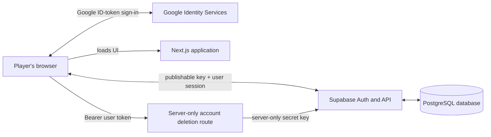

# TG(AI)F codebase and security guide

This guide explains how TG(AI)F works, why the repository is structured this
way, what the security review changed, and how to keep learning without being
afraid of breaking things.

It describes the hardened public snapshot prepared on August 2, 2026. Database
and hosting changes still require separate deployment; see
[Publication status](#publication-status).

## 1. What this application is

TG(AI)F is a small full-stack web application:

- **Next.js** renders the website and provides server routes.
- **React** manages the interactive task list, bamboo plot, and leaderboard.
- **TypeScript** checks many programming mistakes before the app runs.
- **Supabase** provides Google-backed accounts and a PostgreSQL database.
- **Vercel** is the intended hosting platform.
- **GitHub Actions** will check future changes automatically.

The application can also run in a local-preview mode. When Supabase environment
variables are absent, progress stays in the browser and no account is created.

## 2. The big picture



The browser does most of the normal work. It signs in, reads the task list and
leaderboard, and writes the current user's ticks directly through Supabase.
Supabase's row-level security rules decide which database rows each user may
read or change.

The account-deletion route is different. Deleting an authentication user needs
a powerful server credential, so that operation goes through Next.js and never
puts the secret key in browser code.

## 3. Repository tour

| Path | Purpose |
| --- | --- |
| `app/page.tsx` | Main client UI, task data, Google sign-in, Supabase queries, and local-preview state. |
| `app/layout.tsx` | Page metadata such as the title, description, and social image. |
| `app/globals.css` | All visual styling and responsive layout rules. |
| `app/api/account/route.ts` | Authenticates a user token and permanently deletes that same account. |
| `app/auth/callback/route.ts` | Safely completes authorization-code callbacks if that flow is used. |
| `lib/supabase/client.ts` | Creates the browser-side Supabase client. |
| `lib/supabase/server.ts` | Creates a server-side Supabase client using request cookies. |
| `lib/supabase/proxy.ts` | Refreshes Supabase sessions as requests enter the app. |
| `proxy.ts` | Selects which requests pass through the session-refresh logic. |
| `supabase/migrations/` | Versioned SQL instructions that create and update the database. |
| `next.config.ts` | Next.js configuration and browser security headers. |
| `.env.example` | Names and explanations of required configuration, with no real values. |
| `.github/workflows/` | Automated build, dependency review, and CodeQL security checks. |
| `public/og.png` | Image used when the site is shared on social platforms. |

An important learning observation is that the 101 tasks currently exist in both
`app/page.tsx` and a SQL migration. This duplication can drift over time. A good
future refactor would load active tasks from the database, while retaining a
small local-only fixture for preview mode.

## 4. What happens when the app starts

`app/page.tsx` is a Client Component, shown by its `"use client"` first line.
That allows it to use React state, browser storage, and the Google browser SDK.

On startup:

1. The app checks whether the public Supabase URL and publishable key exist.
2. Without them, it loads completed task IDs from `localStorage` and uses a
   local-preview session stored in `sessionStorage`.
3. With them, it asks Supabase to validate the existing user session.
4. For a signed-in user, it loads that user's profile and completions.
5. It loads signed-in leaderboard aggregates and task-completion counts.
6. It subscribes to authentication changes so logging in or out updates the UI.

`localStorage` survives closing the tab or browser. `sessionStorage` normally
lasts only for the current tab session. Neither is appropriate for secrets.
Here they contain only local-preview progress and a simple entered/not-entered
flag.

## 5. Authentication in plain language

### Public identifiers versus secrets

Some configuration is intentionally sent to every visitor's browser:

- `NEXT_PUBLIC_SITE_URL`
- `NEXT_PUBLIC_SUPABASE_URL`
- `NEXT_PUBLIC_SUPABASE_PUBLISHABLE_KEY`
- `NEXT_PUBLIC_GOOGLE_CLIENT_ID`

The `NEXT_PUBLIC_` prefix tells Next.js that a value may be compiled into browser
JavaScript. Supabase publishable keys and Google OAuth client IDs identify a
project; they do not grant administrator access by themselves.

These values must never receive the prefix:

- `SUPABASE_SECRET_KEY`
- `SUPABASE_SERVICE_ROLE_KEY`

Those credentials can perform privileged operations and belong only in the
hosting platform's encrypted server environment.

### Google sign-in flow

1. The page loads Google's Identity Services script over HTTPS.
2. The browser creates a random nonce and sends only its hash to Google.
3. Google returns a signed ID token containing the nonce hash.
4. Supabase checks the ID token and the original nonce.
5. Supabase returns a user session if all checks pass.

The nonce links a sign-in response to the request that started it, making replay
of a captured response harder.

### Account deletion

The browser sends its current Supabase access token to `DELETE /api/account`.
The route asks Supabase which user owns that token and deletes only that user ID.
It does not accept a user ID from the browser. This prevents one player from
asking the route to delete a different account.

## 6. Database design

The initial migration creates three main tables:

| Table | Data | Access rule |
| --- | --- | --- |
| `profiles` | Auth user ID, display name, own avatar URL, timestamps | A user can select only their own row. Profile writes come from the trusted auth trigger. |
| `party_tasks` | Task text, category, order, active flag | Active tasks are readable without an account. |
| `completions` | User ID, task ID, completion time | A user can select, insert, or delete only their own rows. |

There are also two aggregate views:

- `task_completion_counts` returns the number of players who ticked each task.
- `leaderboard` returns display names, scores, and an `is_current_user` flag.

The leaderboard deliberately omits authentication UUIDs, profile photos, and
activity timestamps. It is available only to authenticated players.

### Row-level security

Row-level security, often shortened to **RLS**, is a database firewall applied
to individual rows. The browser may ask for data, but PostgreSQL evaluates the
policy before returning or changing anything.

For example, the completions select policy is conceptually:

```sql
the signed-in user's ID must equal this row's user_id
```

RLS is essential here because a curious user can bypass the React interface and
send requests directly to Supabase. UI checks improve the experience; database
rules provide the real authorization boundary.

### Security-definer functions and views

The database contains trusted functions and aggregate views that need to read
across multiple users. They run with elevated database permissions, so their
outputs must be deliberately narrow.

The functions set an empty `search_path`, qualify database objects explicitly,
and revoke direct execution from browser roles. These measures reduce the risk
of an attacker redirecting a privileged function toward a malicious object.

The task-limit trigger also takes a transaction-level advisory lock. Without
that lock, several simultaneous requests might all observe four ticks and each
insert a fifth tick, exceeding the limit.

## 7. Security findings and fixes

### Secrets and private repository data

- Scanned every current file and all reachable Git commits for common provider
  credentials, private keys, JWTs, and populated environment variables.
- Found no high-confidence credential secrets.
- Removed a hard-coded deployment-specific Google client ID from the current
  source. A Google client ID is public configuration, but keeping a production
  project's identifier out of reusable source is cleaner.
- Expanded `.gitignore` for private keys, certificate stores, service-account
  files, package-manager credential files, and local tool state.
- Confirmed `public/og.png` contains no embedded text or EXIF metadata and does
  not visibly contain people or private information.

### Personal and organizational information

- Removed the specific organization name and location from the current README
  and task copy.
- Configured this clone to use GitHub's no-reply address for future commits.
- Existing public commits still contain a personal author email and the earlier
  organizational text. Changing the latest files does not erase old Git data;
  that requires an approved history rewrite and force-push.

### Database privacy

Before hardening, anonymous users could select profile rows and the public
leaderboard exposed stable auth UUIDs, names, avatars, and activity timestamps.

The hardened schema now:

- lets users read only their own profile row;
- removes unnecessary browser profile-write permissions;
- limits the leaderboard to signed-in players;
- removes auth UUIDs, avatars, and timestamps from leaderboard output;
- tells users on the sign-in screen that their name and score are shared with
  other signed-in players; and
- keeps account deletion as a server-only privileged operation.

The original migration is secure for fresh databases, while
`20260802120000_harden_profile_privacy.sql` upgrades databases that already ran
the earlier schema.

### Redirect and metadata safety

The callback route previously built redirect origins from forwarded host
headers. In a deployment that trusts attacker-controlled forwarding headers,
that can create an open redirect.

Redirects now use validated, same-site relative paths. Values beginning with a
second slash or resolving to another origin fall back to `/`. Provider error
details are replaced with small known error codes so internal messages are not
reflected into the page.

Social metadata now uses the configured canonical site URL instead of deriving
an origin from request headers.

### Browser security headers

`next.config.ts` now sends:

- **Content-Security-Policy** to restrict scripts, connections, frames, images,
  forms, and embedded objects;
- **X-Content-Type-Options** to prevent MIME-type guessing;
- **X-Frame-Options** and CSP `frame-ancestors` to prevent clickjacking;
- **Referrer-Policy** to limit cross-site referrer details;
- **Permissions-Policy** to disable unused browser capabilities;
- **HSTS** to make browsers prefer HTTPS; and
- cross-origin policies compatible with Google's sign-in popup.

The CSP currently permits inline scripts and styles because Next.js and the
Google sign-in integration need them in this setup. A later advanced improvement
would use request-specific CSP nonces and remove `unsafe-inline` from scripts.

### Dependency security

The first npm audit found six vulnerable dependency groups, including five high
severity groups. The codebase now uses the latest stable Next.js patch and
patched transitive versions of Babel, brace-expansion, js-yaml, PostCSS, and
Sharp. PostCSS and Sharp require explicit npm overrides because the latest
stable Next.js release still pins vulnerable ranges.

The final lockfile-only audit reports zero known vulnerabilities. The production
build still needs to confirm that the two narrowly scoped overrides behave
correctly with Next.js.

### GitHub security controls

The review enabled these controls on the GitHub repository:

- secret scanning;
- secret push protection;
- dependency vulnerability alerts;
- Dependabot security updates and automated fixes; and
- private vulnerability reporting.

The repository also now contains:

- a least-privilege CI workflow for lint and production build;
- dependency review that rejects new high-severity dependencies;
- CodeQL static security analysis;
- immutable commit pins for every third-party GitHub Action;
- Dependabot updates for npm and GitHub Actions; and
- a private-reporting policy in `SECURITY.md`.

Branch protection is intentionally not enabled yet. The CI workflow must first
be pushed and run successfully before it can sensibly become a required check.

## 8. Verification performed

Passed:

- current-tree credential-pattern scan;
- full reachable-history credential-pattern scan;
- Git integrity check, including unreachable-object check;
- Git whitespace/error check;
- JSON parsing for `package.json` and `package-lock.json`;
- lockfile resolution inspection for all patched packages;
- offline npm audit: zero known vulnerabilities;
- image visual inspection and PNG metadata inspection; and
- GitHub security-setting verification.

Not yet passed:

- `npm run lint`;
- `npm run build`; and
- live browser testing of local-preview and authenticated flows.

The dependency installation was interrupted by a registry connection reset.
An offline retry could not find one missing package in the cache. This is an
environmental verification blocker, not a known application test failure.

There is currently no automated application test suite. CI checks compilation
and linting, while CodeQL and dependency review cover separate security risks.

## 9. Publication status

The hardened snapshot is the new clean root of the public `main` branch. The
previous author email and organizational identifiers are no longer part of the
normal branch or tag history. The repository uses the permissive MIT License.

Local registry-backed installation was deliberately skipped after an interrupted
download. GitHub CI performs the lint and production-build checks from the
committed lockfile instead. GitHub may need time to recalculate dependency alerts
after the history replacement.

Repository publication and application deployment are separate. Complete these
deployment steps before treating the live application as remediated:

1. Confirm that GitHub CI, dependency review, and CodeQL pass on the new root.
2. Apply every Supabase migration in timestamp order to the deployed database.
3. Confirm production environment variables and Google authorized origins.
4. Exercise sign-in, ticking, reset, leaderboard, log out, and account deletion.
5. Require the passing CI and CodeQL checks through GitHub branch protection.

Because the old commits were already public, a force-push makes them harder to
discover but cannot guarantee that nobody previously copied them. Real leaked
credentials would need rotation regardless of a history rewrite. No such
credential was found in this audit.

## 10. A safe workflow for future changes

1. Create a short-lived branch rather than working directly on `main`.
2. Make one focused change.
3. Add or update a test for the behavior when practical.
4. Run `npm run lint` and `npm run build` locally.
5. Review `git diff` and `git status` before committing.
6. Never use `git add .` blindly when local secret files might exist.
7. Open a pull request and wait for CI, dependency review, and CodeQL.
8. Read generated-code changes before accepting them. Ask what each security
   boundary is and which input an attacker controls.
9. Apply database migrations through a repeatable deployment process, not by
   editing production tables manually.
10. Keep dependencies current through small, frequent updates.

Useful commands:

```bash
npm ci
npm run lint
npm run build
npm audit
git status --short
git diff --check
```

## 11. Suggested learning path

Work through the code in this order:

1. **React state:** Follow `completed` in `app/page.tsx` from initialization to
   rendering and task toggling.
2. **Browser persistence:** Compare local-preview `localStorage` with Supabase
   persistence.
3. **Database authorization:** Read the `completions` RLS policies and imagine
   requests where `auth.uid()` matches or does not match `user_id`.
4. **Authentication:** Trace the Google credential from the callback into
   `signInWithIdToken`, then watch Supabase auth-state changes update the UI.
5. **Server trust boundary:** Compare the publishable browser client with the
   secret-key account-deletion route.
6. **Migrations:** Read the SQL files in timestamp order and observe how a
   deployed database evolves without deleting its history.
7. **Security headers:** Temporarily inspect the browser developer console and
   Network panel to see what the CSP permits or blocks.
8. **Automation:** Read the GitHub Actions YAML and connect each job to the local
   command it reproduces.

Good starter improvements are extracting the task list into a shared typed
module, adding unit tests for redirect validation and task filtering, and adding
an end-to-end test for local-preview mode. These teach architecture without
requiring immediate changes to authentication or privileged database code.

## 12. Short glossary

- **API:** A defined way for one program to request work from another.
- **Authentication:** Proving who a user is.
- **Authorization:** Deciding what that authenticated user may do.
- **Bearer token:** A credential accepted from whoever possesses it; it must be
  protected in transit and storage.
- **CSP:** Browser rules limiting where executable or embedded content may come
  from.
- **Environment variable:** Configuration supplied outside source code.
- **Migration:** A versioned database change applied in order.
- **Nonce:** A random value used once to bind a response to a request.
- **RLS:** PostgreSQL rules that authorize access to individual rows.
- **Secret key:** A server credential with privileged access; never browser data.
- **Supply-chain attack:** Compromise delivered through a dependency or build
  tool rather than code written directly in this repository.
- **XSS:** Attacker-controlled content executing as browser JavaScript.
